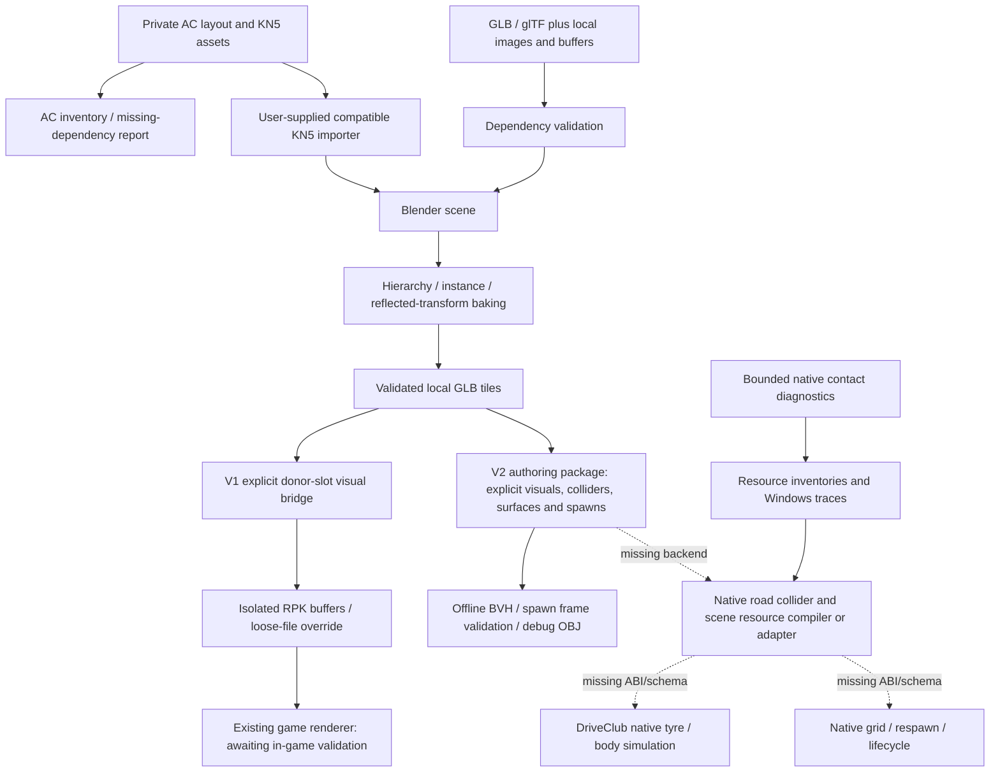

# External-track continuation: implementation and status

This continues `ca8f4cd` on `feat/external-track-foundation`, retaining its modkit
base and original asset. No original dump, prepared game executable or KN5 was
present in the workspace. **The flat loop is still not driveable in DriveClub.**
The source changes below are concrete tools and diagnostics to advance the
render/contact investigation; automated checks do not establish in-game success.

## Implemented changes

- Import review fixes: malformed JSON structures/alignment and malformed RPK
  stream counts now fail explicitly; isolated imports require valid finite
  indexed triangles, refresh normals/tangents even for smaller replacements,
  and permit verification of translated geometry beyond the source-local 10 km
  limit. Staging prepares output first and removes partial publication on errors.
  Default synthetic RPK round trips remain byte-identical.
- The Blender exporter accepts local `.glb`/`.gltf` through `--input`. A preflight
  checks buffer/image dependencies and rejects missing files, remote URLs and
  path escapes before import. Blender evaluates hierarchy/instances/modifiers;
  the exporter bakes evaluated world matrices and fixes reflected winding.
  Materials/textures are inventoried, not converted into DriveClub shaders.
  Existing donor-material limitations remain. Missing textures fail rather than
  quietly producing an incomplete conversion.
- `track_package.py` adds an independent v2 authoring format with explicit visual
  and collision tiles, local origin/yaw/uniform scale, shared source-mesh cache,
  surface metadata and named grid/respawn/pit spawns. The original flat-loop
  `package.json` intentionally assigns the same original geometry to two roles;
  arbitrary visuals never automatically become collision.
- An offline triangle BVH performs nearest ray intersections with normals and
  surface IDs, including slopes, banks, vertical barriers and stacked surfaces.
  Spawn checks ray downward from the proposed origin, compute an orthonormal
  road-aligned frame, and require 0.1–3 m clearance. These are point-support
  checks, not full-car clearance/suspension calibration or native spawn setters.
  Friction values are authoring metadata only. No fake car simulation is used.
- The package owns its data and releases it on context exit/close. Debug OBJ
  output contains separate visual/collision objects, spawn axes and up to 10000
  face-normal lines for inspection in Blender. It does not draw a game overlay.
- Metadata-only RPK evidence collection and safe AC layout/model inventory are
  implemented in the companion guides. A native read-only contact probe records
  existing simulation results in a diagnostic Windows build. It uses the
  existing FFB hook and does not change contacts, tyre forces or vehicle poses.

## Architecture



V2 is currently an authoring/diagnostic loader; it does not install into the game
or supersede the V1 `stage` command. The native backend is deliberately absent
until its resource formats or registration ABI are established. Loading an OBJ
in Blender, or getting a positive BVH hit, does not fill that gap.

## Feature status matrix

| Feature | Status | Practical limit |
|---|---|---|
| Original flat-loop asset and V1 staging | IMPLEMENTED / TESTED | Synthetic RPK round trip; no game rendering validation |
| Buffer isolation, normals, malformed-data handling | IMPLEMENTED / TESTED | Native material/scene dependencies inherited |
| glTF input, dependency checks, hierarchy and instances | IMPLEMENTED / TESTED | Blender 4.3.2; flattened one-primitive output, 65535 vertices per tile |
| V2 explicit collision tiles and surface metadata | IMPLEMENTED / TESTED | Offline; no guest collision-resource output |
| BVH slopes, barriers, nearest support, spawn frames | IMPLEMENTED / TESTED | Point-support authoring checks; no vehicle simulation |
| Package repeated load/close and 30 km tile origin | IMPLEMENTED / TESTED | Python-owned offline memory only |
| Native contact probe helper | IMPLEMENTED / TESTED | Synthetic memory, ASan/UBSan; release builds compile out |
| Native probe Windows integration | IMPLEMENTED / NOT TESTED | Requires diagnostic Windows build and existing FFB callback |
| Original geometry visible in DriveClub | NOT TESTED | Needs user's dump, selected visible slot and capture |
| Native custom road contact / wall collision | BLOCKED | Missing identified native schema/query-registration ABI/lifetime |
| Native spawn/control on imported road | BLOCKED | Native collider plus grid/spawn orientation/body origin unresolved |
| Lap completion/reset/checkpoints | BLOCKED | New route/progress resources not compiled |
| Native PBR/material/texture creation | BLOCKED | Existing mesh/material compatibility constraints |
| KN5/layout discovery and conversion scaffold | IMPLEMENTED / TESTED | Does not decode KN5 or identify road from arbitrary names |
| Full TC2000 import | BLOCKED | Private model not supplied; flat-loop runtime gate incomplete |
| Windows 13900K/4090 performance | NOT TESTED | No profiling measurements or performance promise |
| Nordschleife streaming | NOT TESTED | Tile origins and local limits provide an extension point; no streaming added |

## Use the new authoring tools

From the repository root (PowerShell uses `py -3` in place of `python3`):

```bash
python3 tools/track_import/track_package.py tools/track_import/assets/flat_loop/package.json --debug-obj work/flat-debug.obj
blender --background --python-exit-code 1 --python tools/track_import/blender_export_road.py -- --input private/scene.glb --objects ROAD_A ROAD_B --output private/road.glb
```

Choose new output filenames. Import `work/flat-debug.obj` into Blender; objects
are labelled visual, collision, spawn and collision_face_normals. Inspect a
collider separately from the visual mesh. V2 origins may be far from world zero
while each GLB stays local; a 30 km origin test avoids storing kilometre positions
in half-float vertex buffers. This does not update native scene transforms or
half-float precision automatically during V1 staging.

V2 tiles support an explicit yaw and positive uniform scale, not arbitrary
hierarchy matrices. Bake general GLB hierarchy transforms through Blender first.
For a large circuit, export individually named road tiles and explicit collision
layers; automatic partitioning, multi-slot RPK staging, paging, Vulkan upload
changes and native resource lifetime integration are not implemented. BVH tests
show spatial pruning on 2500 separated triangles; that is not a 20.8 km game
performance benchmark. No premature streaming system was introduced.

## Verified build/test evidence

See `work/phase2/` logs: `full-tests.log` (dcmod build, Python integration tests,
portable probe and Blender), `modkit-tests.log` (existing self-tests and ATRAC9),
`probe-tests.log` (ASan/UBSan helper), `runtime-linux-syntax.log` (Linux branch
only), and `package-report.json`. No game or Windows success is claimed by these
logs. The CI workflow now exercises the new portable checks.

The previous validation record describes the earlier seven-test snapshot. The
new integrated run contains 29 Python tests, including the real synthetic-RPK
import/evidence tools; Blender independently tests translated parent transforms,
shared mesh instances and reflection/winding. The standalone C probe exercises
bounds, bad pointers, no writes and diagnostic lifecycle. Full Windows runtime
compilation/execution, real-data round trips and KN5 decoding remain untested.

## Next actions in priority order

1. Follow `external-track-runtime-probe.md` on the user's Windows PC: stock
   baseline, read-only resource inventory, then a separate staged-visual run.
   Capture the actual original loop in-game and preserve the import report/log.
2. Trace the writers of wheel contact points/surface pointers to the native road
   query, static-world owner and lifetime. Establish both road and barrier paths.
   Decode the corresponding resource format or confirm a safe registration ABI.
3. Implement that native backend for one original plane and a slope/barrier,
   with donor contact excluded from the test region. Establish grid/spawn body
   transform and native reset. Only a normal car resting/driving there passes.
4. Add a new loop route and a single valid lap before AI, menus or visual polish.
5. Inventory the privately supplied TC2000 layout; verify approximately 2.045 km
   against the actual model/layout, scale and direction. Use a compatible local
   KN5 importer, author explicit road/collision/barrier selections and spawns,
   then run the proven native backend. AC AI/physics files remain reference data.

## Preservation and transfer

Existing `ca8f4cd` and both earlier handoff files were preserved under
`work/phase2/preserved/`. Updated bundles/patches are in `work/phase2/handoff/`.
The bundle is incremental against modkit
`2a7108906b6d44d3179138da1fe04cc266cc5897` and includes the original foundation
plus continuation commits. The `continuation.patch` applies after `ca8f4cd`;
`all-development.patch` applies after the modkit base.

The GitHub connector is authenticated; no DriveClub fork was found among the
account's accessible owned repositories, and only the upstream remote is
configured locally. No upstream push, branch overwrite or new remote was made.
Create a fork in GitHub, then from your Windows clone:

```powershell
git fetch 'D:\handoff\external-track-foundation.bundle' feat/external-track-foundation:refs/remotes/handoff/external-track-foundation
git switch -c external-track-review refs/remotes/handoff/external-track-foundation
git remote add myfork https://github.com/YOUR_ACCOUNT/driveclub-recomp.git
git push --dry-run myfork HEAD:refs/heads/external-track-review
git push myfork HEAD:refs/heads/external-track-review
```

Use a fresh branch name if it already exists. Do not use `--force` and do not
push to `origin` when it points to OverkillLabs3. If starting from scratch, clone
the public repository first so the bundle's modkit prerequisite exists. The
previous Windows guide contains exact modkit build steps; the runtime-probe
guide adds the diagnostic build and a reversible isolated-profile experiment.
