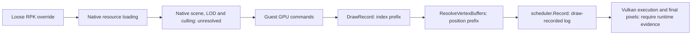

# Donor-local marker and draw recording experiment

**Next diagnostic step:** the three Windows runs at `5913035` found no index
matches, including stock. Use the [probe calibration experiment](external-track-probe-calibration.md)
before interpreting those zeros. It adds actual-draw capture/later replay and
progressive counters; its descriptions supersede the original probe counters below.

## Current evidence

Windows testing has confirmed that `BB_DMEM_MB=8056` fixes the reported startup
launch, menus/driving work, the loose RPK override loads, its SHA256 matches the
staged file, and Road742 main re-exports as 8 vertices / 8 triangles. No visible
change has been confirmed. These results establish file replacement and serialized
geometry replacement, **not use of that geometry by a visible draw**.

The user-reported 15 compatible road-name candidates have these triangle counts:

| Group | Main | LOD1 | LOD2 | LOD3 |
|---|---:|---:|---:|---:|
| Road743 | 160 | 60 | 22 | — |
| Road742 | 65 | 27 | 13 | 9 |
| Road740 | 102 | 35 | 19 | 6 |
| Road728 | 608 | 302 | 143 | 71 |

These are reported group labels, not a decoded native LOD selector. No source
evidence currently establishes which candidate is selected in a given camera
view, whether another resource overrides its ID, or its native world transform.
Do not replace all LODs at once: that would obscure the next experiment's result.

The reported 35,189-vertex stream and index resource shared by 146 slots are
buffer capacities/sharing counts, not Road742's own geometry size. Its selected
vertex/index intervals must remain distinct from those neighbors.

## Source findings

`tools/modkit/src/cmd_mesh.cpp`:

* `FindSubs` recognizes `02 03` range records and preceding buffer IDs. It checks
  absolute 16-bit indices against the declared vertex interval. Submesh records
  may repeat. This is a bounded interpretation of known resource layouts, not
  a complete mesh/scene schema.
* `IndependentMentions` checks independently replaceable vertex-stream ID locations.
  `ImportSub --isolate-buffers` clones whole vertex records into new resources,
  rewrites those references and adds dependencies. It **appends** index bytes to
  the existing shared index resource, preserving neighboring index ranges.
* Both the recognized range records and all matching `(3, lo, 0, first, count)`
  draw-record patterns are updated. Finding these bytes does not prove they are
  the active native draw records. This experiment does not change that writer.
* The scanner now exposes mesh resource ID, range endpoints, record offsets,
  direct local resource consumers, and a bounded native position/index prefix
  signature. Consumers are dependency-table references in this pack only; they
  do not establish scene membership, LOD thresholds, transforms or visibility.

`gpu/shadps4/video_core/renderer_vulkan/vk_rasterizer.cpp`:

* `Draw` selects a pipeline and either invokes `DrawRecord` or sends the work to
  the draw-recording thread. Instrumenting only `Draw` would miss the resolved
  bindings on the second thread.
* `ResolveVertexBuffers` uses validated prepared inputs or the fetch shader's
  vertex-input descriptors. `GetDrawOffsets` supplies the actual base vertex.
* `ResolveIndexBuffer` uses the guest index-base address plus the command's index
  offset. `DrawRecord` queues `drawIndexed` in `scheduler.Record`.
* The backend consumes GPU commands. It does not receive a reliable RPK mesh
  name/ID or a decoded road/scene instance. CPU scene selection and native
  culling occur upstream; shader transforms, depth, materials, draw filtering,
  and occlusion can still affect the final image.



The previous flat loop extended beyond its donor bounds. That introduces an
uncontrolled difference; it does **not** prove culling caused the unchanged view.
Other possibilities remain: a different part/LOD/instance is used, a later pack
supplies the resource, the native draw consumes an unrecognized record, the
replacement is elsewhere, or underlying geometry/materials conceal the change.

## Controlled marker

`tools/track_import/visual_marker.py` starts from one **original** exact mesh slot
and generates three probe signatures plus two isolated replacement RPKs:

* **stock**: no override, original byte-prefix signature;
* **control**: original geometry re-imported through buffer isolation;
* **marker**: positive uniform scaling to 25% about its mesh-local AABB center.

The inset is intended to leave a conspicuous gap around a small retained patch.
It preserves all vertex/triangle counts, vertex order, winding, normals and UVs.
Consequently the importer's opaque donor-record correspondence stays unchanged.
All replacement vertices remain within the measured donor vertex bounds; no
scene/culling records, material assignment, colors, collision or spawn data are
modified. Other geometry underneath can conceal the inset, so this is a test,
not a promise of a visible hole. Geometry remains private and donor-derived.

The tool uses the existing scanner/importer validation, refuses skinning and
incompatible slots, initially requires float32 positions, validates GLBs, checks
re-exported topology/positions, requires a fresh output directory and hashes the
source/dependencies before and after. A failure can leave an incomplete output
directory for inspection; only a completed run writes `marker-report.json`.

## Optional probe and limits

Only diagnostics builds honor `BB_MESH_PROBE`. Set it to the **contents** of the
generated `*-probe.txt`, not the filename. The signature is strictly parsed and
contains stride, encoding width, sample count, index count, first vertex, up to
eight native XYZ records and up to 24 16-bit indices. Both 16/32-bit draw indices
and signed base-vertex offsets are checked. Reads use the existing bounded
backing-memory API, without modifying permissions, buffers or GPU synchronization.

`MeshProbe: draw-recorded signature-match` means the direct indexed command had
the expected index count/prefix and a bound stream with the expected position
prefix, and reached Vulkan command recording. It is **not** GPU completion,
main-camera selection, visibility, or unique resource identity: identical
geometry can match too. Inset coordinates help distinguish the marker from stock.
The first 20 matches log vertex/index addresses and vertex/fragment shader hashes.
Five-second progress reports show cumulative counters per recording thread.

Indirect draws are counted as `indirect-unchecked`. Shader-side vertex pulling,
GPU-generated/stale backing data, repacked vertices/indices, changed draw counts,
or descriptor offsets not matching the native representation can evade detection.
Invalid signatures disable the probe with an explicit message. Zero matches are
inconclusive. No messages can mean the diagnostics build/environment is wrong or
the recording path was not reached. Disable the probe for performance comparisons.

## Update and build — MSYS2 CLANG64

```bash
cd /h/DC-Track-Test
set -euo pipefail
git switch feat/external-track-foundation
git fetch https://github.com/orsarusi312/driveclub-recomp.git feat/external-track-foundation
git merge --ff-only FETCH_HEAD
mkdir -p work
bash tools/track_import/test.sh 2>&1 | tee work/marker-tests-windows.log
BB_DIAGNOSTICS=ON BB_PGO=off BB_LTO=OFF bash build.sh
git rev-parse HEAD
```

The test script rebuilds dcmod and the standalone probe. It does not build the
game runtime; the last build command does that. No reset/clean or upstream push
is used. Resolve local conflicts without discarding existing work.

## Prepare — PowerShell

```powershell
$ErrorActionPreference = 'Stop'
$Repo = 'H:\DC-Track-Test'
Set-Location $Repo
$DC = "$Repo\out\dcmod.exe"
$Source = "$Repo\work\visual-recovery\worlds\canada_road_circuit_02_n.rpk"
$Global = "$Repo\work\dependencies\global.rpk"
$Common = "$Repo\work\dependencies\worlds\canada_common.rpk"
$Target = '000862187dac760f_0_polyRoadShape742'
$Experiment = "$Repo\work\visual-marker-$([guid]::NewGuid().ToString('N'))"
py -3 tools/track_import/visual_marker.py $Source --target $Target `
    --dependency $Global --dependency $Common --dcmod $DC --factor 0.25 -o $Experiment
if ($LASTEXITCODE -ne 0) { throw 'Marker preparation failed; do not install its partial outputs' }
Get-Content "$Experiment\marker-report.json"
git rev-parse HEAD | Set-Content "$Experiment\commit.txt"
```

Inspect `donor.glb`, `control-roundtrip.glb`, and `marker-roundtrip.glb` together
in Blender. Do not use the previously modified flat-loop RPK as `$Source`.
The existing `work\visual-recovery\staged` output and
`work\multistream-ea121055b3cd415e84ce2f65990c6063\flat-loop-visual-test\mods`
are retained untouched. This experiment uses new mod directories.

## Run stock, control and marker separately — PowerShell

Reuse the prepared files that worked with the 8056 MiB budget. The function
below clears inherited `BB_*` overrides during each child launch and restores
them afterward. Each run has fresh saves/config/cache and only one optional RPK
override. Existing executables, saves, configuration and original dumps remain intact.

```powershell
$RuntimeDir = Read-Host 'Working runtime folder containing the EXE and its DLLs'
$Prep = Read-Host 'Existing prepared folder containing boot-linked.bin, content.bin, patches.bin'
$Update = Read-Host 'Original Update folder (--app0)'
$Base = Read-Host 'Original Base folder (--app0-base)'
$Runtime = Join-Path $RuntimeDir "DriveClubGame.marker-$([guid]::NewGuid().ToString('N')).exe"
Copy-Item -LiteralPath "$Repo\out\DriveClubGame.diagnostics.exe" -Destination $Runtime
Get-FileHash -LiteralPath $Runtime | Format-List | Out-File "$Experiment\runtime-hash.txt"

function Invoke-MarkerTrial([string]$Variant) {
    if ($Variant -notin @('stock','control','marker')) { throw 'Unknown variant' }
    $Run = Join-Path $Experiment $Variant
    if (Test-Path -LiteralPath $Run) { throw 'Run directory exists; retain its evidence and choose a new experiment' }
    New-Item -ItemType Directory "$Run\user","$Run\mods\worlds","$Run\logs" | Out-Null
    if ($Variant -ne 'stock') {
        $Active = "$Run\mods\worlds\canada_road_circuit_02_n.rpk"
        Copy-Item -LiteralPath "$Experiment\$Variant.rpk" -Destination $Active
        if ((Get-FileHash $Active).Hash -ne (Get-FileHash "$Experiment\$Variant.rpk").Hash) { throw 'Copy hash mismatch' }
    }
    $Saved = @{}
    Get-ChildItem Env:BB_* | ForEach-Object { $Saved[$_.Name]=$_.Value }
    $OldLayers=$env:VK_LOADER_LAYERS_DISABLE
    try {
        Get-ChildItem Env:BB_* | ForEach-Object { Remove-Item -LiteralPath "Env:$($_.Name)" }
        $env:BB_DMEM_MB='8056'
        $env:BB_MESH_PROBE=(Get-Content -Raw "$Experiment\$Variant-probe.txt").Trim()
        $env:BB_GPU_USER_DIR="$Run\user"
        $env:BB_CONFIG="$Run\user\driveclub.ini"
        $env:BB_TOGGLE_FILE="$Run\user\toggles.txt"
        $env:BB_CRASH_DIR="$Run\logs"
        $env:VK_LOADER_LAYERS_DISABLE='~implicit~'
        $ArgsList=@("$Prep\boot-linked.bin",'--content-profile',"$Prep\content.bin",
            '--patches',"$Prep\patches.bin",'--app0',$Update,'--app0-base',$Base,
            '--user',"$Run\user",'--mods',"$Run\mods",'--stub-unresolved','--timeout','900')
        foreach ($Arg in $ArgsList) { if ($Arg.Contains('"')) { throw 'Argument contains a quote' } }
        $Quoted=($ArgsList | ForEach-Object { '"'+$_+'"' }) -join ' '
        $Process=Start-Process -FilePath $Runtime -ArgumentList $Quoted -WorkingDirectory $RuntimeDir `
            -RedirectStandardOutput "$Run\logs\stdout.log" -RedirectStandardError "$Run\logs\stderr.log" -Wait -PassThru
        $Process.ExitCode | Set-Content "$Run\logs\exit-code.txt"
    } finally {
        Get-ChildItem Env:BB_* | ForEach-Object { Remove-Item -LiteralPath "Env:$($_.Name)" }
        foreach ($Name in $Saved.Keys) { Set-Item -LiteralPath "Env:$Name" -Value $Saved[$Name] }
        $env:VK_LOADER_LAYERS_DISABLE=$OldLayers
    }
    Select-String -Path "$Run\logs\*.log" -Pattern 'MeshProbe:','replaced by mods folder','Fault:'
}

Invoke-MarkerTrial 'stock'
Invoke-MarkerTrial 'control'
Invoke-MarkerTrial 'marker'
```

In each run select the same Fraser Valley route, car, weather/time and camera;
drive the same full lap and capture matching viewpoints. Close the game normally
before moving to the next run. Fresh user folders may require initial setup.
The target's route location is not yet known. The 900-second timeout is a bound,
not a success criterion. No benchmark, track physics probe or other mod is enabled.

## Interpret and collect

* **Stock and control match:** isolation preserved an observable geometry path.
* **Marker draw matches:** the changed position data reached direct draw recording;
  if still invisible, investigate the logged pass/shaders, occlusion and transforms.
* **Stock matches, control does not:** investigate rebinding/native draw interpretation
  before changing LODs or culling. A negative probe result still has coverage limits.
* **Nothing matches:** first check `enabled`, progress counters, route coverage and
  indirect draws. Then consider other resource providers and selection. Do not
  conclude “LOD problem” from this alone.

Return the small `marker-report.json`, commit, runtime hash, three run logs and
matching screenshots. Keep GLBs, RPKs, prepared binaries and prefix signature files
local. Removing only the new runtime copy and experiment folder reverses the test.
No collision or drivability on replacement geometry is asserted.

## Validation and limits of this development environment

Standalone probe tests cover strict signature parsing, 16/32-bit indices, shared
stream offsets, signed base vertices, bounded/failed reads, stale-match reset,
read-only behavior and diagnostics OFF/ON gating. Synthetic RPK tests cover
control/marker roundtrips, unchanged neighboring geometry, shared index append,
consumer metadata, malformed position stride, and scanner-to-probe format agreement.
Validation recovered/completed for this milestone:

* `bash tools/track_import/test.sh`: 61 Python tests passed without skips,
  standalone probe OFF/ON, native contact-probe tests and Blender 4.3.2 smoke,
  hierarchy/instances/reflection checks passed. Blender reported its optional
  Draco library unavailable; these uncompressed GLB tests completed successfully.
* `SANITIZE=1 bash tools/test_mesh_probe.sh`: ASan/UBSan passed, OFF/ON.
* `bash tools/modkit/test.sh`: all checks passed; ATRAC9 encoder passed
  (channel SNR 45.0 / 67.8 dB).
* Windows LLVM-MinGW cross-compilation of the standalone probe: passed;
  Windows execution is not available here.
* Full GPU runtime build: blocked in this workspace (CMake is not installed and
  the GPU SDK/build dependencies are unavailable). The added call sites were
  reviewed against the actual direct/prepared/two-thread/indirect paths, but
  **the complete renderer translation unit and runtime were not built here**.

The full Windows build, prepared/ordinary vertex-binding paths in-game, and
actual road visibility require the user's build/run. No new game archives were
supplied here. No rendering root cause has been established, and no correction
to native LOD, scene bounds, materials or transforms is claimed.
